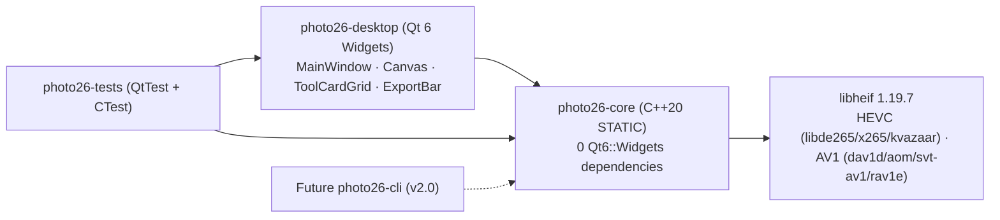

<div align="center">

# Photo26

### Native Windows x64 Image Toolbox — 100% Local, Fast, and Non-Destructive

[](https://github.com/JaviBlzq/Photo26/releases/latest)
[](CMakeLists.txt)
[](docs/architecture.md)
[](docs/feature-matrix.md)
[](docs/architecture.md)
[](https://github.com/JaviBlzq/Photo26/releases/latest)

**19 essential image tools in a single native desktop application** — including full out-of-the-box support for **Apple HEIC, HEIF/HIF, AVIF, macOS ICNS, and Apple ProRAW (DNG)**, with no cloud uploads, no accounts, and atomic non-destructive saving.

[Download Portable v1.1.0](https://github.com/JaviBlzq/Photo26/releases/latest) · [User Manual](docs/user-manual.md) · [Architecture](docs/architecture.md) · [Test Report](docs/test-report.md) · [Performance](docs/performance-report.md)

</div>

---

## Quick Download (Windows 10 / 11 x64)

Photo26 ships as a **self-contained portable package** — no installer, no Qt SDK, no Python, and no administrator privileges required:

1. Download **`Photo26-v1.1.0-win64-portable.zip`** from the [Latest Release](https://github.com/JaviBlzq/Photo26/releases/latest).
2. Extract it to any folder (for example `C:\Photo26\`).
3. Run **`photo26.exe`**.

> **Integrity verification:** Every release includes an official `.sha256` checksum asset.

---

## Why Photo26

| Principle | What it means in practice |
| :--- | :--- |
| **100% local & private** | All decoding, pixel processing, metadata editing, and PDF/ZIP export run locally on your CPU and RAM. Zero telemetry, zero accounts, zero external services. |
| **Full Apple & modern format support** | Native **HEIC**, **HEIF/HIF**, **AVIF** (`libheif 1.19.7` with HEVC & AV1 codecs bundled), **Apple ICNS**, and **Apple ProRAW / DNG** reading across all tools. |
| **Non-destructive by default** | Original files are never overwritten without confirmation. Every write goes through atomic transactional staging (`SafeFileWriter`). |
| **Clean desktop export workflow** | Native Windows dialogs (*Save As…*, *Save Files…*, and ***Save as ZIP…***), smart descriptive filenames, conflict preview, and remembered last export folder. |
| **Clean, natural UI** | Neutral light desktop theme by default (with optional charcoal dark mode), contextual toolbar without redundant controls, drag & drop, zoom/pan canvas, and *Before / After* split view. |
| **Decoupled C++20 engine (`photo26-core`)** | Zero dependency on `Qt6::Widgets`, ready to power a future CLI without duplicating processing logic. |

---

## All 19 Built-in Tools

### Conversion & Optimization
| Tool | Highlights |
| :--- | :--- |
| **Format Converter** | Convert across **Apple HEIC, HEIF/HIF, AVIF, Apple ICNS, Apple ProRAW/DNG (read), PNG, JPEG, WebP, BMP, TIFF, GIF, ICO, PPM/PGM/PBM/XBM/XPM**, and vector **SVG/SVGZ** rasterization, with alpha flattening and ICC color space conversion (`sRGB`, `Adobe RGB`, `Display P3`, `ProPhoto RGB`). |
| **Image Compressor** | Fine-grained quality (`1..100`) for **JPEG, PNG, WebP, HEIC, HEIF, and AVIF**, lossless mode where supported, target file size budget (KiB), and live original vs. compressed savings comparison. |
| **Web Optimizer** | Responsive multi-width export (`320`, `640`, `960`, `1280`, `1920 px`) in **WebP, AVIF, HEIC, JPEG, or PNG** without upscaling, optional metadata stripping, and folder or ZIP export. |
| **Favicon & Icon Generator** | Multi-resolution Windows `.ico` (`16, 32, 48, 256 px`), **macOS `.icns`** export, full PNG icon set (`16..512 px`), and PWA `site.webmanifest`. |
| **Batch Processor** | Multi-threaded async pipeline (format conversion, resize, color adjustments, watermark, metadata, renaming) supporting **HEIC/HEIF/AVIF/ICNS/DNG**, JSON presets, live progress, and cooperative cancellation. |

### Editing & Geometry
| Tool | Highlights |
| :--- | :--- |
| **Crop & Straighten** | Interactive crop overlay with rule-of-thirds guides (`Free`, `1:1`, `3:4`, `4:3`, `16:9`, `9:16`, `2:3`, `3:2`, `21:9`, and custom ratios), `90°`/free-angle rotation, and horizontal/vertical flip. |
| **Resize & Rotate** | Resize by pixels, percentage, or bounding box, aspect ratio lock, upscale prevention, and high-precision **Lanczos-3**, Bicubic, Bilinear, or Nearest interpolation (16-bit `RGBA64` and premultiplied alpha safe). |
| **Color & Filters** | Rec.709 grayscale, B&W with Floyd-Steinberg dithering, sepia, invert, brightness, contrast, saturation, gamma, and linear-light exposure (EV) in 16-bit per channel precision. |
| **Local Background Removal** | 100% local CPU segmentation (border-connected CIE L\*a\*b\* flood, Chroma Key, luminance threshold) with Gaussian edge feathering and transparency or solid color replacement. |
| **Watermark** | Text or PNG logo overlays with 10 anchor positions (including tiled mode), opacity, scale, margins, and rotation. |

### Composition & Documents
| Tool | Highlights |
| :--- | :--- |
| **Combine & Collage** | Horizontal, vertical, grid, and mosaic layouts with margins, spacing, alignment, custom/transparent backgrounds, and aspect-ratio-preserving scaling. |
| **Text, Frames & Borders** | Text overlays, outer padding, colored borders, and transparent rounded corners. |
| **Images to PDF** | Local single-page and multi-page PDF generation (`ISO 32000-1`) with `A4`, `Letter`, `Legal`, `A3`, or *Fit to Image*, orientation, margins, and DPI control. |
| **Animated GIF** | Built-in `GIF89a` encoder with per-frame delay, `NETSCAPE2.0` looping, optional dithering, and frame extraction to folder. |
| **Spritesheets** | Pack multiple frames into a grid texture atlas and export the JSON coordinate map. |

### Metadata & Utilities
| Tool | Highlights |
| :--- | :--- |
| **Metadata Inspector & Cleaner** | Separates filesystem properties from embedded **EXIF, XMP, IPTC, ICC, and GPS** metadata; edits 15 fields, copies metadata between images, exports/imports schema-validated JSON (`photo26.metadata.v1`), strips all or selected categories (losslessly for JPEG/PNG/WebP and natively for **HEIC/HEIF/AVIF**), and supports batch updates. |
| **Color Palette Extractor** | Deterministic k-means++ dominant color extraction with HEX/RGB codes, dominance ratios, and export to JSON, CSS variables, GIMP `.gpl`, or PNG swatches. |
| **Visual Image Comparator** | Side-by-side, interactive *Before / After* split slider, overlay blend, visual diff map, and quantitative `MAE`, `RMSE`, and `PSNR` metrics. |
| **Smart Mass Rename** | Pattern engine (`{name}`, `{num}`, `{date}`, `{width}`, `{height}`, `{ext}` — including dimensions probed from **HEIC/HEIF/AVIF**), prefix/suffix, find & replace, live preview, and conflict detection. |

---

## Supported Formats & Transparent Scope

| Format | Extensions | Read | Write | Alpha | Metadata (`EXIF`/`XMP`/`IPTC`/`ICC`) | Notes |
| :--- | :--- | :---: | :---: | :---: | :---: | :--- |
| **Apple HEIC** | `.heic`, `.heics` | **Yes** | **Yes** | **Yes** | EXIF · XMP · ICC | Bundled `libheif 1.19.7` + HEVC (`libde265`, `x265`, `kvazaar`), quality & lossless |
| **HEIF / HIF** | `.heif`, `.hif`, `.heifs` | **Yes** | **Yes** | **Yes** | EXIF · XMP · ICC | Full ISO/IEC 23008-12 support across all tools |
| **AVIF** | `.avif`, `.avis` | **Yes** | **Yes** | **Yes** | EXIF · XMP · ICC | Bundled AV1 (`dav1d`, `aom`, `svt-av1`, `rav1e`), quality & lossless |
| **Apple ICNS** | `.icns` | **Yes** | **Yes** | **Yes** | — | Native macOS icon format (`qicns.dll`), multi-resolution |
| **Apple ProRAW / DNG** | `.dng` | **Yes** | No | — | EXIF · XMP · IPTC · ICC | Extracts highest-resolution image frame & full metadata |
| **JPEG** | `.jpg`, `.jpeg` | **Yes** | **Yes** | Flattened | EXIF · XMP · IPTC · ICC | Metadata edit/strip without re-encoding JPEG scan |
| **PNG** | `.png` | **Yes** | **Yes** | **Yes** (8/16-bit) | EXIF · XMP · ICC | CRC-32 verified `eXIf`, `iTXt`, `iCCP`, `pHYs` chunks |
| **WebP** | `.webp` | **Yes** | **Yes** | **Yes** | EXIF · XMP · ICC | Lossy and lossless encoding |
| **TIFF** | `.tif`, `.tiff` | **Yes** | **Yes** | **Yes** | EXIF · XMP · IPTC · ICC | Direct IFD metadata stripping |
| **GIF** | `.gif` | **Yes** | **Yes** | **Yes** (1-bit) | — | Built-in animated `GIF89a` encoder & frame extractor |
| **Windows ICO** | `.ico` | **Yes** | **Yes** | **Yes** (32-bit) | — | Multi-resolution (`16..256 px`) + PWA bundle |
| **BMP / Netpbm / X11** | `.bmp`, `.ppm`, `.pgm`, `.pbm`, `.xbm`, `.xpm` | **Yes** | **Yes** | Format-dependent | — | Lossless raster support |
| **SVG / SVGZ** | `.svg`, `.svgz` | **Yes** | No | **Yes** | — | Vector rasterization via `QSvgRenderer`; never wraps bitmaps into fake SVG |
| **PDF** | `.pdf` | No | **Yes** | Page fill | Document title | Single-page & multi-page PDF export (`ISO 32000-1`) |

> **Honest scope notes:** Background removal runs 100% locally on CPU (no external ONNX model is bundled in the standard portable build). **OCR** is intentionally excluded.

---

## Verified Performance (Windows 11 x64)

Measured natively on Windows 11 x64 (`AMD Ryzen 7 9800X3D`, Release portable build with clean `PATH=C:\Windows\System32;C:\Windows`):

| Benchmark / Verification | Measured Result |
| :--- | :--- |
| Cold startup of `photo26.exe` (portable, clean `PATH`) | **`369 – 384 ms`** |
| Idle memory after `1,500 ms` | **`113.35 MiB`** Working Set · **`51.06 MiB`** Private Commit |
| Lanczos-3 Resize (`1920×1080 → 960×540`) | **`32 ms`** |
| Full HD PNG load / WebP q85 save | **`72 ms`** / **`77 ms`** |
| Web Optimizer (5 responsive WebP variants) | **`262 ms`** |
| **20× Full HD parallel batch** (Lanczos-3 + 16-bit color + WebP, 4 threads) | **`713 ms`** (`35.6 ms/image`, `-73.9%` size, `+0.75 MiB` net RAM delta) |
| Automated test suite (`CTest` + native Win32 `QtTest`, 11/11 blocks) | **`1.26 s`** (`100% PASS`) |
| PE32+ dependency audit (`objdump -p`, 48 binaries, 296 import edges) | **`0` missing non-Windows DLLs** |

---

## Architecture



```text
Photo26/
├── CMakeLists.txt            # Targets: photo26-core, photo26-desktop-lib, photo26, photo26-tests
├── src/
│   ├── core/                 # Decoupled C++20 engine (common, io/heif_codec, metadata, color, ops)
│   └── desktop/              # Qt 6 Widgets UI (MainWindow, Canvas, ToolCardGrid, ExportBar, ThemeManager)
├── tests/                    # Automated unit, format, Apple/HEIF, metadata & GUI test suite
├── docs/                     # Architecture, user manual, test & performance reports, licenses
├── vcpkg.json                # Reproducible vcpkg dependency manifest
└── conanfile.txt             # Alternative Conan 2 manifest
```

---

## Building from Source (Windows x64)

Requirements: **Qt 6.8+ (`win64_mingw`)**, **MinGW-w64 GCC 13+ (C++20)**, **CMake 3.25+**, **Ninja**, and optionally **libheif (`PHOTO26_HEIF_ROOT`)** for native HEIC/HEIF/AVIF support.

```powershell
cmake -S . -B build -G Ninja `
  -DCMAKE_BUILD_TYPE=Release `
  -DCMAKE_PREFIX_PATH="C:\Path\To\Qt\6.8.3\mingw_64" `
  -DPHOTO26_HEIF_ROOT="C:\Path\To\heif\mingw64"

cmake --build build --config Release
ctest --test-dir build --output-on-failure
```

To build a self-contained portable folder, deploy Qt runtimes with `windeployqt.exe --release --compiler-runtime` and copy the `libheif` codec DLLs alongside `photo26.exe`. See [docs/build-instructions.md](docs/build-instructions.md) for full details.

---

## Documentation & Licenses

- [User Manual](docs/user-manual.md)
- [Technical Architecture](docs/architecture.md)
- [Feature & Format Matrix](docs/feature-matrix.md)
- [Test & Verification Report](docs/test-report.md)
- [Performance & Memory Report](docs/performance-report.md)
- [Build & Packaging Instructions](docs/build-instructions.md)
- [Dependencies](docs/dependencies.md) & [Third-Party Licenses](docs/licenses.md) (Qt 6 under LGPL-3.0, `libheif`/`libde265` under LGPL-3.0, AV1/HEVC codec notices included in `licenses/`).
