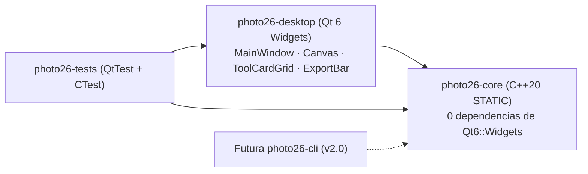

<div align="center">

# Photo26

### Suite nativa de herramientas de imagen para Windows x64 — 100 % local, rápida y no destructiva

[](https://github.com/JaviBlzq/Photo26/releases/latest)
[](CMakeLists.txt)
[](docs/architecture.md)
[](docs/architecture.md)
[](https://github.com/JaviBlzq/Photo26/releases/latest)

**19 herramientas fotográficas en una sola aplicación nativa**, inspirada en la simplicidad práctica de las cajas de herramientas de escritorio, sin nube, sin cuentas y sin sobrescribir tus archivos originales.

[Descargar Portable v1.0.0](https://github.com/JaviBlzq/Photo26/releases/latest) · [Manual de usuario](docs/user-manual.md) · [Arquitectura](docs/architecture.md) · [Informe de pruebas](docs/test-report.md) · [Rendimiento](docs/performance-report.md)

</div>

---

## Descarga rápida (Windows 10 / 11 x64)

Photo26 se distribuye como **paquete portable autocontenido** — no requiere instalador, Qt SDK, Python ni permisos de administrador:

1. Descarga **`Photo26-v1.0.0-win64-portable.zip`** desde la página de [Releases](https://github.com/JaviBlzq/Photo26/releases/latest).
2. Descomprime el archivo en cualquier carpeta (por ejemplo `C:\Photo26\`).
3. Ejecuta **`photo26.exe`**.

> **Verificación de integridad:** Cada lanzamiento incluye su archivo `.sha256` oficial en los activos de la Release.

---

## Por qué Photo26

| Principio | Qué significa en la práctica |
| :--- | :--- |
| **100 % local y privado** | Todo el procesamiento ocurre en tu CPU/RAM local. Sin cuentas, sin telemetría, sin subir tus fotografías a servidores externos. |
| **No destructivo por defecto** | Tus imágenes originales nunca se modifican sin confirmación. Toda escritura a disco es transaccional y atómica (`SafeFileWriter`). |
| **Guardado limpio y directo** | Diálogos nativos de Windows («Guardar como…», «Guardar archivos…» y **«Guardar como ZIP…»**), nombres descriptivos sugeridos y recuerdo de la última carpeta. |
| **Interfaz natural de escritorio** | Diseño sobrio en tema claro neutro (con modo oscuro opcional), arrastrar y soltar, vista previa interactiva con zoom/pan y cortina *Antes / Después*. |
| **Núcleo desacoplado (`photo26-core`)** | Motor C++20 con cero dependencias de `Qt6::Widgets`, listo para compartir lógica con una futura CLI sin duplicar código. |

---

## Catálogo de herramientas (19 herramientas)

### Conversión y optimización
| Herramienta | Capacidades principales |
| :--- | :--- |
| **Convertir formato** | PNG, JPEG, WebP, BMP, TIFF, GIF, ICO, PPM/PGM/PBM/XBM/XPM, rasterización vectorial SVG/SVGZ, aplanado de transparencia y conversión de perfiles ICC (`sRGB`, `Adobe RGB`, `Display P3`, `ProPhoto RGB`). |
| **Comprimir imagen** | Control de calidad (`1..100`), modo sin pérdida cuando el formato lo admite, tamaño objetivo aproximado en KiB y comparativa de peso original vs. final. |
| **Optimizar para Web** | Generación responsive a `320`, `640`, `960`, `1280` y `1920 px` sin ampliaciones, limpieza de metadatos y exportación en carpeta o ZIP. |
| **Generador de Favicon e ICO** | Contenedor `.ico` multi-resolución (`16, 32, 48, 256 px`), paquete completo de PNGs (`16..512 px`) y `site.webmanifest` PWA. |
| **Procesamiento por lotes** | Tubería asíncrona multi-hilo (conversión, redimensionado, color, marca de agua, metadatos, renombrado), presets JSON, progreso y cancelación cooperativa. |

### Edición y geometría
| Herramienta | Capacidades principales |
| :--- | :--- |
| **Recortar y enderezar** | Recorte interactivo sobre lienzo con regla de los tercios (`Libre`, `1:1`, `3:4`, `4:3`, `16:9`, `9:16`, `2:3`, `3:2`, `21:9` y personalizado), rotación `90°`/libre y volteo H/V. |
| **Redimensionar y rotar** | Por píxeles, porcentaje o dimensiones máximas, con bloqueo de ampliaciones e interpolación `Lanczos-3` separable, `Bicúbica`, `Bilineal` y `Nearest` (soporte 16 bits `RGBA64`). |
| **Ajustes de color y filtros** | Escala de grises Rec.709, B/N con tramado Floyd-Steinberg, sepia, inversión, brillo, contraste, saturación, gamma y exposición (EV) en 16 bits por canal. |
| **Eliminar fondo / Transparencia** | Segmentación 100 % local sobre CPU (inundación conectada desde bordes en CIE L\*a\*b\*, Chroma Key y umbral de luminancia), suavizado gaussiano y reemplazo por transparencia o color sólido. |
| **Marca de agua** | Texto o logotipo PNG, 10 posiciones (incluido mosaico), escala, opacidad, margen y rotación. |

### Composición y documentos
| Herramienta | Capacidades principales |
| :--- | :--- |
| **Combinar y collage** | Unión horizontal, vertical, cuadrícula y mosaico con márgenes, espaciado, alineación y fondos personalizables sin deformar proporciones. |
| **Texto, marcos y bordes** | Superposición de texto, relleno exterior, bordes de color y esquinas redondeadas con canal alfa. |
| **Imágenes a PDF** | Exportación local a PDF (`ISO 32000-1`) de una o múltiples páginas con tamaño (`A4`, `Letter`, `Legal`, `A3`, ajuste a imagen), orientación, márgenes y DPI. |
| **Animación GIF / Secuencia** | Codificador binario `GIF89a` propio con retardo por fotograma, repeticiones (`NETSCAPE2.0`), tramado opcional y extracción de fotogramas. |
| **Hoja de Sprites (Spritesheet)** | Empaquetado en atlas de cuadrícula y exportación del mapa de coordenadas JSON. |

### Metadatos y utilidades
| Herramienta | Capacidades principales |
| :--- | :--- |
| **Inspector y limpieza de metadatos** | Propiedades de disco vs. metadatos incrustados (`EXIF`, `XMP`, `IPTC`, `ICC`, `GPS`), edición de 15 campos, copia entre archivos, exportación/importación JSON (`photo26.metadata.v1`), limpieza total/selectiva sin recodificar JPEG/PNG/WebP y edición por lotes. |
| **Extractor de paleta de colores** | Cuantización determinista k-means++ con códigos HEX/RGB, dominancia y exportación a JSON, variables CSS, GIMP `.gpl` y muestras PNG. |
| **Comparador visual** | Lado a lado, deslizador *Antes / Después*, superposición, mapa de diferencias visuales y métricas `MAE`, `RMSE` y `PSNR`. |
| **Renombrado masivo inteligente** | Patrones (`{name}`, `{num}`, `{date}`, `{width}`, `{height}`, `{ext}`), prefijos, sufijos, buscar/sustituir, vista previa en vivo y detección de conflictos. |

---

## Formatos soportados y declaraciones honestas

| Formato | Lectura | Escritura | Transparencia | Metadatos (`EXIF`/`XMP`/`IPTC`/`ICC`) | Notas |
| :--- | :---: | :---: | :---: | :---: | :--- |
| **JPEG** (`.jpg`, `.jpeg`) | Sí | Sí | Aplanado | EXIF · XMP · IPTC · ICC | Edición/limpieza sin recodificar el scan JPEG |
| **PNG** (`.png`) | Sí | Sí | Sí (8/16 bits) | EXIF · XMP · ICC | Chunks `eXIf`, `iTXt`, `iCCP`, `pHYs` con CRC-32 |
| **WebP** (`.webp`) | Sí | Sí | Sí | EXIF · XMP · ICC | Con pérdida y sin pérdida (`lossless`) |
| **TIFF** (`.tif`, `.tiff`) | Sí | Sí | Sí | EXIF · XMP · IPTC · ICC | Limpieza directa en estructura IFD |
| **GIF** (`.gif`) | Sí | Sí | Sí (1 bit) | — | Codificador animado `GIF89a` propio + extractor |
| **ICO** (`.ico`) | Sí | Sí | Sí (32 bits) | — | Multi-resolución (`16..256 px`) + paquete PWA |
| **BMP / PPM / PGM / PBM / XBM / XPM** | Sí | Sí | Según formato | — | Sin pérdida |
| **SVG / SVGZ** | Sí | No | Sí | — | Rasterización con `QSvgRenderer`; no envuelve bitmaps en falso SVG |
| **PDF** | No | Sí | Fondo de página | Título | Exportación de 1 o varias imágenes (`ISO 32000-1`) |
| **HEIC / HEIF / AVIF** | Condicional | Condicional | Sí | Según plugin | Detección nativa ISOBMFF; decodificación activa si hay plugin Qt/`libheif` en el sistema |

> **Nota sobre eliminación de fondos:** La versión portable estándar v1.0 realiza la segmentación 100 % en CPU local (sin empaquetar modelos ONNX). **OCR** está expresamente excluido del alcance del proyecto.

---

## Rendimiento real medido (Windows 11 x64)

Mediciones reales tomadas sobre Windows 11 x64 (`AMD Ryzen 7 9800X3D`, paquete portable Release con `PATH` limpio):

| Operación | Resultado medido |
| :--- | :--- |
| Arranque en frío de `photo26.exe` (portable) | **`376 – 384 ms`** |
| Memoria en reposo (`1,500 ms`) | **`113.35 MiB`** Working Set · **`51.06 MiB`** Private Commit |
| Redimensionado Lanczos-3 (`1920×1080 → 960×540`) | **`32 ms`** |
| Carga PNG Full HD / Guardado WebP q85 Full HD | **`72 ms`** / **`77 ms`** |
| Web Optimizer (5 variantes responsive WebP) | **`262 ms`** |
| **Lote paralelo de 20 imágenes Full HD** (resize + color 16-bit + WebP, 4 hilos) | **`713 ms`** (`35.6 ms/img`, reducción `-73.9 %`, delta RAM `+0.75 MiB`) |
| Suite automatizada (`CTest` + `QtTest`, 10/10 bloques) | **`437 – 500 ms`** (`100 % PASS`) |

Consulta todos los detalles en [docs/performance-report.md](docs/performance-report.md) y [docs/test-report.md](docs/test-report.md).

---

## Arquitectura del proyecto



```text
Photo26/
├── CMakeLists.txt            # Targets: photo26-core, photo26-desktop-lib, photo26, photo26-tests
├── src/
│   ├── core/                 # Motor C++20 desacoplado (common, io, metadata, color, ops)
│   └── desktop/              # Interfaz Qt 6 Widgets (MainWindow y widgets interactivos)
├── tests/                    # Suite automatizada unitaria, de formatos, metadatos y GUI
├── docs/                     # Arquitectura, manual de usuario, pruebas, rendimiento y licencias
├── vcpkg.json                # Manifiesto reproducible de dependencias
└── conanfile.txt             # Alternativa reproducible Conan 2
```

---

## Compilación desde el código fuente (Windows x64)

Requisitos: **Qt 6.8+ (`win64_mingw`)**, **MinGW-w64 GCC 13+ (C++20)**, **CMake 3.25+** y **Ninja**.

```powershell
cmake -S . -B build -G Ninja `
  -DCMAKE_BUILD_TYPE=Release `
  -DCMAKE_PREFIX_PATH="C:\Ruta\A\Qt\6.8.3\mingw_64"

cmake --build build --config Release
ctest --test-dir build --output-on-failure
```

Para generar el paquete portable autocontenido, despliega las bibliotecas con `windeployqt.exe --release --compiler-runtime`. Consulta la guía completa en [docs/build-instructions.md](docs/build-instructions.md).

---

## Documentación y licencias

- [Manual de usuario completo](docs/user-manual.md)
- [Arquitectura técnica](docs/architecture.md)
- [Matriz de funcionalidades y formatos](docs/feature-matrix.md)
- [Informe de pruebas y verificación](docs/test-report.md)
- [Informe de rendimiento y memoria](docs/performance-report.md)
- [Instrucciones de compilación y empaquetado](docs/build-instructions.md)
- [Dependencias](docs/dependencies.md) y [Licencias de terceros](docs/licenses.md) (Qt 6 bajo LGPL-3.0, MinGW-w64 / GCC Runtime Library Exception).
