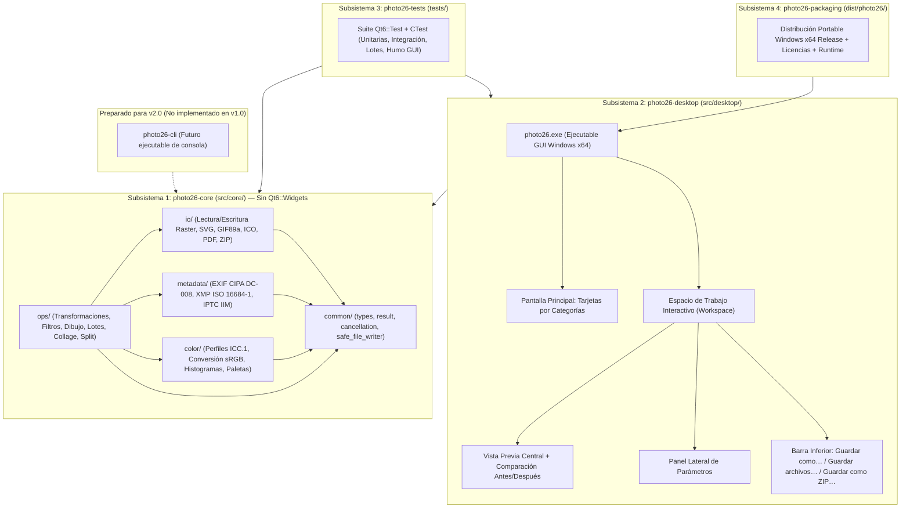
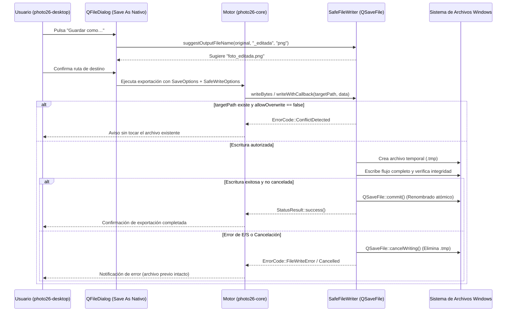

# Photo26 v1.0 — Documento de Arquitectura Técnica (`architecture.md`)

**Fecha:** 2026-11-04  
**Versión de Arquitectura:** 1.0  
**Plataforma Objetivo:** Windows 10 / Windows 11 x64 (`x86_64-w64-mingw32`, PE32+ GUI)  
**Estándar C++:** C++20 (`CMAKE_CXX_STANDARD 20`, `-std=c++20`)  
**Framework y Toolchain:** Qt 6.8.3 (`win64_mingw`), MinGW-w64 GCC 13.1.0, CMake 3.30.5, Ninja 1.12.1  

---

## 1. Visión General de la Arquitectura Modular de Photo26 v1.0

**Photo26 v1.0** es una estación de trabajo de edición, conversión, inspección de metadatos y procesamiento de imágenes **100% nativa de escritorio para Windows 10 y Windows 11 (x64)**, desarrollada en **C++20** con **Qt 6.8.3 Widgets**.

### 1.1. Principios Arquitectónicos Innegociables

1. **Ejecución 100% Local y Offline (Cero Telemetría, Cero Servidores):**
   - Todo el procesamiento de píxeles, rasterización vectorial/PDF, empaquetado binario, manipulación de metadatos y gestión de color ocurre exclusivamente en la CPU/RAM local del equipo del usuario.
   - No existen llamadas HTTP/HTTPS, telemetría analítica, servicios en la nube ni servidores intermedios. Las bibliotecas de red de Qt que `windeployqt.exe` pueda arrastrar por plugins táctiles o de plataforma permanecen inactivas en el flujo de la aplicación.
2. **Separación Estricta entre Núcleo (`photo26-core`) e Interfaz (`photo26-desktop`):**
   - El motor algorítmico (`photo26-core`) está completamente desacoplado de `Qt6::Widgets`. Opera únicamente sobre estructuras de datos explícitas, tipos de valor C++20 (`Result<T>`, `StatusResult`, `OperationError`) y primitivas no visuales de Qt (`Qt6::Core`, `Qt6::Gui`, `Qt6::Svg`).
3. **Edición No Destructiva por Defecto y Persistencia Atómica:**
   - Ninguna operación modifica ni trunca el archivo original de entrada a menos que el usuario lo autorice explícitamente mediante un diálogo de confirmación o la opción explícita de sobrescritura (`SafeWriteOptions::allowOverwrite`).
   - Toda escritura en disco se realiza de forma transaccional y atómica mediante `SafeFileWriter` respaldado por `QSaveFile`.
4. **Determinismo y Manejo Explícito de Errores:**
   - En lugar de propagar excepciones no controladas a través de fronteras de módulos o hilos, todas las operaciones de E/S, metadatos, color y transformación devuelven `Result<T>` o `StatusResult` con códigos tipados en `ErrorCode` (`FileNotFound`, `UnsupportedFormat`, `CorruptedInput`, `ImageDimensionsTooLarge`, `MetadataIncompatible`, `SchemaValidationError`, `ConflictDetected`, `Cancelled`, etc.).

### 1.2. Diagrama General de Capas y Subsistemas

---

## 2. Separación Estricta de los 4 Subsistemas Obligatorios

El árbol del proyecto se estructura en cuatro subsistemas con responsabilidades, fronteras de enlace CMake y artefactos estrictamente delimitados:

### 2.1. Subsistema 1: `photo26-core` (`src/core/`)

Biblioteca estática C++20 (`STATIC`) que encapsula la totalidad de la lógica de negocio y procesamiento de imagen.
- **Restricción de enlace:** Tiene **prohibido** enlazar con `Qt6::Widgets` o incluir cabeceras de controles visuales (`QWidget`, `QMainWindow`, `QDialog`, `QFileDialog`, etc.). Enlaza exclusivamente con `Qt6::Core`, `Qt6::Gui`, `Qt6::Svg` y las bibliotecas de formato/compresión del sistema.
- **Organización modular interna en 5 dominios (`src/core/`):**
  1. **`common/`** ([`types.hpp`](file:///home/jblaz/dev/photo26/src/core/common/types.hpp), [`result.hpp`](file:///home/jblaz/dev/photo26/src/core/common/result.hpp), [`cancellation.hpp`](file:///home/jblaz/dev/photo26/src/core/common/cancellation.hpp), [`safe_file_writer.hpp`](file:///home/jblaz/dev/photo26/src/core/common/safe_file_writer.hpp)):
     - Tipos transversales (`ErrorCode`, `OperationError`, `Result<T>`, `StatusResult`, `ImageLimits`, `FormatCapability`, `SaveOptions`).
     - Primitivas de concurrencia y cancelación cooperativa (`CancellationToken`, `ProgressCallback`).
     - Escritura atómica y resolución de nombres de salida (`SafeFileWriter`, `SafeWriteOptions`).
  2. **`io/`**:
     - Registro y matriz de capacidades de formatos (`FormatRegistry` / `FormatCapability`: JPEG, PNG, WebP, BMP, TIFF, GIF, ICO, SVG, PDF, HEIC/HEIF/AVIF según plugins/codecs disponibles).
     - Decodificación segura con verificación previa de límites (`ImageLimits`) y rasterización bajo demanda de gráficos vectoriales SVG (`QSvgRenderer`) a dimensiones configurables (`svgRasterWidth`, `svgRasterHeight`).
     - Codificadores y empaquetadores especializados: escritor multi-resolución Windows ICO (`16x16` a `256x256`), ensamblador GIF89a animado con cuantización de paleta, generador de documentos PDF multi-página (`QPdfWriter` / `QPagedPaintDevice`) y empaquetador de archivos PKZIP (`.zip`) en flujo continuo.
  3. **`metadata/`**:
     - Motor de lectura, inspección, edición, saneado (eliminación selectiva o total por privacidad), exportación e importación JSON de metadatos fotográficos: **EXIF** (CIPA DC-008), **XMP** (ISO 16684-1) e **IPTC Photo Metadata** (IIM).
     - Verificación de compatibilidad de contenedor destino (`MetadataIncompatible`) y validación estricta de esquemas JSON al importar metadatos (`SchemaValidationError`).
  4. **`color/`**:
     - Inspección, preservación, extracción y conversión de perfiles de color **ICC** (`ICC.1`), incluyendo transformación a espacio estándar sRGB cuando se solicita o para visualización consistente.
     - Cálculo de histogramas por canal (R, G, B, Luminancia), extracción de paletas dominantes (cuantización cromática con exportación de códigos HEX/RGB) y muestreo de píxeles de alta precisión.
  5. **`ops/`**:
     - **Geometría y Dimensiones:** Redimensionado (por píxeles o porcentaje, con bloqueo de relación de aspecto y filtro de remuestreo suave), recorte libre o con proporciones fijas (`1:1`, `4:3`, `16:9`, etc.), rotación (`90°`, `180°`, `270°` y ángulo libre con relleno configurable), volteo horizontal/vertical, expansión de lienzo (padding/bordes) y división de imagen en cuadrícula (`M x N` fragmentos).
     - **Ajustes Tonales, Filtros y Efectos:** Brillo, contraste, saturación, exposición, temperatura, matiz, conversión a escala de grises, sepia, inversión negativa, desenfoque gaussiano/caja, enfoque (sharpen), pixelado/censura por región y redondeo de esquinas con canal alfa.
     - **Composición, Anotación y Marca de Agua:** Superposición de marcas de agua de texto y logotipo (con control de opacidad, rotación, posición/mosaico), dibujo vectorial/anotación sobre imagen (rectángulos, flechas, trazos libres, texto), generador de collages/mosaicos multi-imagen y comparación visual píxel a píxel (mapa de diferencias y métricas MAE/PSNR).
     - **Compresión, Conversión y Procesamiento por Lotes:** Compresión optimizada con estimación de tamaño, conversión individual o masiva de formatos, renombrado secuencial por patrones (`{name}`, `{index}`, `{date}`, `{width}x{height}`) y ejecutor de tuberías por lotes (`BatchProcessor`) con soporte de `CancellationToken` y `ProgressCallback`.

### 2.2. Subsistema 2: `photo26-desktop` (`src/desktop/`)

Contiene la biblioteca de interfaz gráfica de usuario (`photo26-desktop-ui`) y el ejecutable nativo de Windows (`photo26.exe`, subsistema `WIN32`). Enlaza con `photo26-core` y `Qt6::Widgets`.
- **Pantalla Principal de Tarjetas por Categorías:**
  - Vista de inicio limpia y estructurada que organiza todas las herramientas de Photo26 en tarjetas interactivas agrupadas por categorías funcionales (Edición Básica, Conversión y Compresión, Metadatos y Color, Composición y Anotación, Procesamiento por Lotes), con buscador instantáneo de herramientas.
- **Espacio de Trabajo Interactivo (Workspace):**
  - **Vista Previa Central Interactiva:** Lienzo con zoom, desplazamiento (pan), superposición de guías de recorte/división/anotación y modo de **comparación Antes/Después** (vista dividida deslizable o conmutación rápida entre imagen original e imagen procesada).
  - **Panel Lateral de Parámetros:** Controles específicos de la herramienta activa (sliders con entrada numérica exacta, selectores de formato y calidad, editor tabular de etiquetas EXIF/XMP/IPTC, selector de color y configuración de lote).
  - **Barra Inferior de Exportación No Destructiva:** Acciones de salida estandarizadas que invocan siempre diálogos nativos de Windows (`QFileDialog`) y delegan la escritura en `SafeFileWriter`:
    - `Guardar como…`: Exportación de un único archivo resultante con nombre descriptivo sugerido automáticamente (p. ej., `foto_recortada.png`) sin sobrescribir el original.
    - `Guardar archivos…`: Exportación de múltiples resultados (operaciones por lotes, división en cuadrícula o extracción de fotogramas) hacia una carpeta seleccionada por el usuario, con detección de colisiones.
    - `Guardar como ZIP…`: Empaquetado directo de todos los archivos generados por una operación multi-salida en un único contenedor `.zip` estándar seleccionado mediante diálogo `Save As`.

### 2.3. Subsistema 3: `photo26-tests` (`tests/`)

Suite automatizada de verificación continua construida sobre **`Qt6::Test`** y orquestada mediante **`CTest`**.
- **Pruebas Unitarias de `photo26-core`:** Validación determinista de `Result<T>`, `SafeFileWriter` (escritura atómica, rechazo de colisiones con `ConflictDetected`, sugerencia de nombres), `CancellationToken` y límites `ImageLimits`.
- **Pruebas de Formatos y Estándares (`io/`):** Ciclo completo de lectura y escritura (round-trip) en JPEG, PNG, WebP, BMP, TIFF, GIF89a animado, ICO multi-resolución, rasterización SVG, generación de PDF y empaquetado PKZIP, más manejo de archivos truncados/corruptos (`CorruptedInput`).
- **Pruebas de Metadatos y Color (`metadata/` y `color/`):** Preservación, edición, borrado y exportación/importación JSON de EXIF, XMP e IPTC; rechazo de JSON malformado (`SchemaValidationError`); lectura y preservación de perfiles ICC; cálculo de histogramas y paletas.
- **Pruebas de Operaciones y Lotes (`ops/`):** Verificación geométrica y cromática de cada operación de imagen, procesamiento por lotes en streaming archivo por archivo y cancelación cooperativa a mitad de lote.
- **Pruebas de Humo e Integración GUI (`photo26-desktop`):** Instanciación sin bloqueos de la ventana principal, navegación entre la pantalla de tarjetas por categorías y el espacio de trabajo, interacción con controles de parámetros y verificación de banderas de autodiagnóstico (`--self-test`).

### 2.4. Subsistema 4: `photo26-packaging` (`dist/photo26/`)

Artefacto de distribución portable **Windows x64 Release** listo para ejecutarse sin instalador ni permisos de administrador en cualquier equipo Windows 10/11 x64 con el `PATH` limpio:
- Ejecutable principal `dist/photo26/photo26.exe` compilado en modo `Release` con MinGW-w64 GCC 13.1.0 (`-O3` / `-O2`, subsistema PE32+ GUI).
- Despliegue automatizado con `windeployqt.exe --release --compiler-runtime`:
  - Bibliotecas dinámicas esenciales de Qt 6.8.3 (`Qt6Core.dll`, `Qt6Gui.dll`, `Qt6Widgets.dll`, `Qt6Svg.dll`, etc.).
  - Runtime C++20 y POSIX Threads de MinGW-w64 (`libstdc++-6.dll`, `libgcc_s_seh-1.dll`, `libwinpthread-1.dll`).
  - Plugins de plataforma (`platforms/qwindows.dll`), estilos (`styles/qmodernwindowsstyle.dll`), motores de iconos (`iconengines/qsvgicon.dll`) y formatos de imagen (`imageformats/qgif.dll`, `qicns.dll`, `qico.dll`, `qjpeg.dll`, `qsvg.dll`, `qtga.dll`, `qtiff.dll`, `qwbmp.dll`, `qwebp.dll`).
- Directorio `dist/photo26/licenses/` con textos íntegros de licencias (`LGPL-3.0.txt`, `GCC-RUNTIME-LIBRARY-EXCEPTION.txt`, `MINGW-W64-RUNTIME.txt`, `WINPTHREADS-COPYING.txt`, `THIRD-PARTY-NOTICES.txt` y documentos SBOM SPDX de Qt 6.8.3).

---

## 3. Preparación del Núcleo para una Futura CLI (`photo26-cli`) en v2.0

> [!IMPORTANT]
> **Alcance de la versión actual:** Conforme a la especificación del proyecto, la interfaz de línea de comandos (`photo26-cli`) **NO se implementa en Photo26 v1.0**. El entregable de usuario de v1.0 es exclusivamente la aplicación gráfica de escritorio `photo26.exe`.

Sin embargo, la arquitectura de `photo26-core` está diseñada desde el primer día para que la incorporación de `photo26-cli` en una futura versión **v2.0** requiera **cero duplicación de algoritmos** y **cero refactorización del motor**:

1. **Ausencia Total de Dependencias Visuales en `photo26-core`:**
   - Ninguna función de `photo26::core` abre cuadros de diálogo (`QMessageBox`, `QFileDialog`), ni lee widgets, ni depende de un bucle de eventos gráficos `QApplication`.
   - Un futuro ejecutable `photo26-cli` podrá instanciar únicamente `QCoreApplication` o `QGuiApplication` (para soporte de fuentes y renderizado headless en `QImage`/`QPdfWriter`) y enlazar directamente con `photo26-core`.
2. **Contratos de Entrada/Salida Basados en Estructuras Puras:**
   - Todas las operaciones reciben structs de configuración serializables (como `SaveOptions`, `SafeWriteOptions`, `ImageLimits` y los structs de parámetros de `ops/`), rutas de sistema de archivos (`QString`) o buffers en memoria (`QImage`, `QByteArray`), y devuelven `Result<T>` o `StatusResult`.
3. **Progreso y Cancelación Agnósticos de la Interfaz:**
   - El motor informa del avance mediante el callback funcional `ProgressCallback` (`std::function<void(int completed, int total, const QString& currentItem)>`) y consulta la parada mediante `CancellationToken` (`std::atomic<bool>` compartido).
   - En `photo26-desktop` (v1.0), `ProgressCallback` actualiza una barra de progreso `QProgressBar` y el botón "Cancelar" invoca `token.cancel()`.
   - En una futura `photo26-cli` (v2.0), el mismo `ProgressCallback` imprimirá el porcentaje en `stderr`/`stdout` y un manejador de señal `SIGINT` (`Ctrl+C`) invocará `token.cancel()`.

---

## 4. Cumplimiento de Estándares Oficiales

Photo26 v1.0 implementa y verifica el cumplimiento estricto de los siguientes estándares internacionales y de la industria:

| Estándar / Formato | Especificación de Referencia | Implementación y Garantías en Photo26 v1.0 |
| :--- | :--- | :--- |
| **EXIF** | **CIPA DC-008 / JEITA CP-3451** (*Exchangeable image file format for digital still cameras*) | Lectura, visualización estructurada, edición de etiquetas principales (Orientation, Make, Model, DateTimeOriginal, ExposureTime, FNumber, ISO, GPS, Artist, Copyright), preservación al guardar (`SaveOptions::preserveMetadata`), eliminación de privacidad y exportación/importación JSON. |
| **XMP** | **ISO 16684-1** (*Extensible Metadata Platform — Part 1: Data model, serialization and core properties*) | Procesamiento de paquetes XML/RDF XMP incrustados (`dc:title`, `dc:description`, `dc:subject`, `dc:creator`, `dc:rights`, `xmp:Rating`, `xmp:CreateDate`), preservación entre conversiones compatibles y serialización JSON validada. |
| **IPTC** | **IPTC Photo Metadata Standard / IIM** (*Information Interchange Model*) | Soporte de conjuntos de datos IPTC Application Record 2 (Headline, Caption/Abstract, Keywords, By-line, Credit, CopyrightNotice, City, Country), sincronización coherente y limpieza selectiva o total. |
| **Perfiles ICC** | **ISO 15076-1 / ICC.1** (*Image technology colour management — Architecture, profile format and data structure*) | Extracción e inspección de perfiles `QColorSpace` / ICC incrustados en imágenes de entrada, preservación del perfil original en la salida (`SaveOptions::preserveIccProfile`) y conversión controlada al espacio de color estándar **IEC 61966-2-1 (sRGB)**. |
| **GIF89a** | **CompuServe GIF89a Specification** (*Graphics Interchange Format Version 89a*) | Generación de secuencias animadas multipágina con bloque de extensión de control gráfico (*Graphic Control Extension*), retardo por fotograma configurable en centésimas de segundo, extensión de bucle (*NETSCAPE2.0 Application Extension*) y cuantización de color a paleta indexada de hasta 256 colores. |
| **Windows ICO** | **Formato de Recursos de Icono de Microsoft Windows (`ICONDIR` / `ICONDIRENTRY`)** | Generación de contenedores `.ico` multi-resolución que empaquetan simultáneamente vistas escaladas con canal alfa de 32 bits (`16x16`, `24x24`, `32x32`, `48x48`, `64x64`, `128x128` y `256x256` con codificación PNG interna conforme a Windows Vista/10/11). |
| **PKZIP** | **APPNOTE.TXT — .ZIP File Format Specification (PKWARE)** | Creación de archivos `.zip` conformes al estándar con encabezados de archivo local (*Local File Header*), compresión DEFLATE, sumas de verificación CRC-32 IEEE 802.3 y directorio central (*Central Directory*) al final del archivo para exportación de lotes y divisiones. |
| **PDF** | **ISO 32000-1 (PDF 1.4 / 1.7)** (*Portable Document Format*) | Generación local de documentos PDF de una o múltiples páginas a partir de colecciones de imágenes mediante `QPdfWriter`, respetando tamaños de página estándar (A4, Carta o ajustado a la dimensión de cada imagen), márgenes y resolución DPI configurable. |

---

## 5. Gestión de Memoria Acotada, Concurrencia y Escritura Atómica

Para garantizar estabilidad absoluta en equipos de escritorio Windows sin agotamiento de RAM (*Out-Of-Memory*), bloqueos de la interfaz ni corrupción de datos, Photo26 v1.0 aplica cuatro mecanismos de seguridad en `photo26-core`:

### 5.1. Límites Configurables de Dimensiones y Tamaño (`ImageLimits`)

Definido en [`src/core/common/types.hpp`](file:///home/jblaz/dev/photo26/src/core/common/types.hpp#L39-L44), el struct `ImageLimits` establece techos de seguridad verificados **antes** de reservar buffers de píxeles en memoria:
- `maxWidth`: `32,768` píxeles por defecto.
- `maxHeight`: `32,768` píxeles por defecto.
- `maxPixels`: `134,217,728` píxeles (**128 Megapíxeles** por defecto, equivalente a ~512 MiB en RGBA8888 descomprimido).
- `maxFileBytes`: `536,870,912` bytes (**512 MiB** de tamaño máximo de archivo de entrada por defecto).

El subsistema `io/` inspecciona el tamaño en disco (`QFileInfo::size()`) y las cabeceras del contenedor de imagen (`QImageReader::size()`) antes de decodificar la matriz de píxeles. Si un archivo supera cualquiera de los umbrales de `ImageLimits`, la operación se aborta de inmediato de forma limpia devolviendo `ErrorCode::ImageDimensionsTooLarge`, protegiendo al proceso frente a bombas de descompresión (*decompression bombs*).

### 5.2. Procesamiento por Lotes en Streaming Archivo por Archivo

En las operaciones masivas (conversión por lotes, redimensionado masivo, marca de agua en lote, renombrado o empaquetado en ZIP), **Photo26 nunca carga todas las imágenes del lote simultáneamente en RAM**:
1. El ejecutor de lotes recibe la lista de rutas de entrada (`QStringList`) y procesa los elementos **secuencialmente o con un grado de paralelismo estrictamente acotado**.
2. En cada iteración del lote:
   - Se valida el archivo actual frente a `ImageLimits`.
   - Se decodifica una única instancia `QImage` y su paquete de metadatos.
   - Se aplica el pipeline de transformación solicitado (`ops/`, `color/`, `metadata/`).
   - Se persiste el resultado inmediatamente en disco mediante `SafeFileWriter` (o se escribe la entrada comprimida en el flujo del archivo `.zip`).
   - Se destruye el `QImage` de la iteración actual, liberando su buffer de memoria antes de abrir el siguiente archivo.
3. De este modo, el consumo máximo de RAM de un lote de 1,000 fotografías es idéntico al de procesar una sola fotografía.

### 5.3. Cancelación Cooperativa Segura entre Hilos (`CancellationToken`)

Definida en [`src/core/common/cancellation.hpp`](file:///home/jblaz/dev/photo26/src/core/common/cancellation.hpp#L10-L35), la clase `CancellationToken` encapsula un `std::shared_ptr<std::atomic<bool>>` libre de bloqueos (*lock-free* con `std::memory_order_relaxed`):
- Puede copiarse de forma ligera entre el hilo de la interfaz gráfica (`photo26-desktop`) y los hilos trabajadores de procesamiento (`photo26-core`).
- Los bucles costosos (procesamiento por lotes, generación de PDF multipágina, empaquetado ZIP, cuantización GIF89a y filtros por píxel) consultan `token.isCancelled()` periódicamente.
- Si el usuario solicita cancelar, el motor detiene el procesamiento de inmediato, descarta cualquier archivo temporal en curso sin confirmar en disco y devuelve `ErrorCode::Cancelled`, dejando el sistema de archivos intacto.

### 5.4. Escritura Atómica y No Destructiva (`SafeFileWriter` con `QSaveFile`)

Definida en [`src/core/common/safe_file_writer.hpp`](file:///home/jblaz/dev/photo26/src/core/common/safe_file_writer.hpp#L10-L37), la clase `SafeFileWriter` centraliza toda salida a disco del proyecto bajo tres reglas de hierro:
1. **Protección contra Sobrescritura Accidental:**
   - Por defecto, `SafeWriteOptions::allowOverwrite` es `false`. Si la ruta de destino (`targetPath`) ya existe en el sistema de archivos, `SafeFileWriter` aborta antes de abrir ningún archivo y devuelve `ErrorCode::ConflictDetected`.
2. **Transaccionalidad Atómica mediante `QSaveFile`:**
   - Tanto `SafeFileWriter::writeBytes` como `SafeFileWriter::writeWithCallback` escriben primero la totalidad de los bytes en un archivo temporal adyacente gestionado por `QSaveFile`.
   - Solo si la codificación de la imagen, la inyección de metadatos y el volcado a disco concluyen sin errores (`isOk()`), se invoca `QSaveFile::commit()`, que renombra atómicamente el archivo temporal sobre el destino final a nivel del sistema operativo Windows (NTFS).
   - Si ocurre un fallo de codificación, falta de espacio en disco o cancelación del usuario a mitad de escritura, `QSaveFile::cancelWriting()` elimina automáticamente el archivo temporal sin dejar archivos corruptos o a medio escribir de 0 bytes.
3. **Generación de Nombres Descriptivos sin Colisión (`suggestOutputFileName`):**
   - `SafeFileWriter::suggestOutputFileName` construye sugerencias claras en español para los diálogos `Save As` basadas en el nombre original y la operación aplicada (por ejemplo, `retrato_redimensionado.jpg`, `documento_recortado.png`, `lote_convertido.zip`), añadiendo sufijos incrementales (`_1`, `_2`, …) cuando `avoidCollision` está activo.

